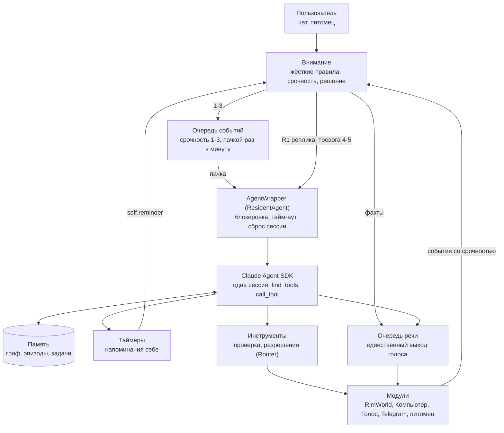

# Схема работы агента

Упрощённая схема ядра: как обращение или событие доходит до единого агента и что он делает дальше. Подробная схема со всеми
сервисами и контрактами собирается из `agent/tools/architecture/spec.py` (вкладка «Схема» в GUI, `docs/architecture-clean.html`).
Эта схема нарисована в Minecraft и уточнена по коду; при смене потока событий её нужно править вместе со `spec.py`.

## Как читать

- **Внимание** принимает всё: сообщения пользователя, события модулей, самоимпульсы (таймеры, итоги, сон). Жёсткие правила
  («замолчи», ответ да/нет на разрешение R2, mute R3, критичное R4) срабатывают до любых моделей. Срочность 0-5 задаёт модуль,
  ядро её не оценивает. Решение: 0 выбросить, 1-3 во входящую очередь, 4-5 тревога единому агенту (обрывает его работу).
- **Единый агент** это одна постоянная сессия Claude (`agent/app/resident.py`). Своих встроенных инструментов у него нет, только
  `find_tools` и `call_tool` ядра. Память он читает и пишет сам.
- **Очередь речи** (`speech_queue.py`) единственное место, откуда звучит голос: туда идут реплики агента и факты из внимания.
